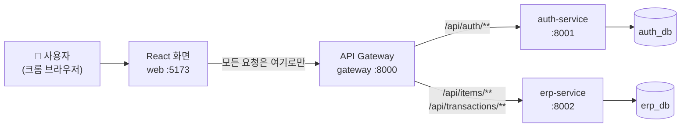
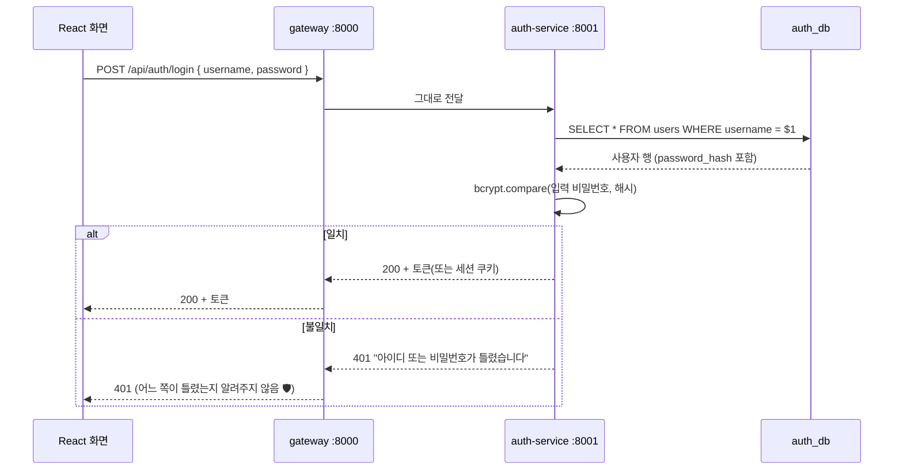
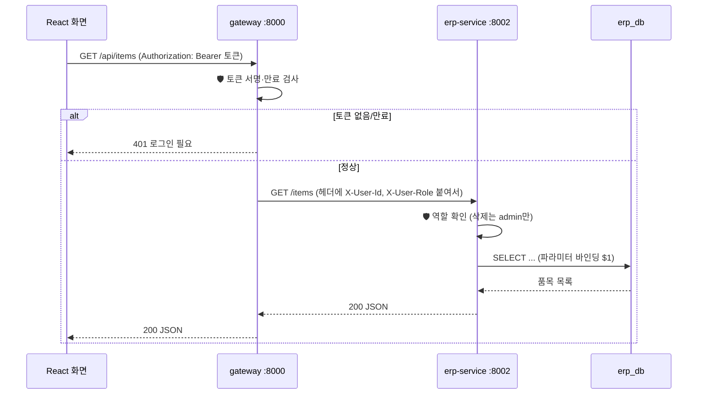

# 20. 아키텍처 — 시스템을 어떻게 나눌 것인가

> Phase 2 산출물 ①. "무엇을 만들지"(기획서)가 정해졌으니 이제 **"어떻게 만들지"**를 그림과 표로 정합니다.
> 작성일: 2026-11-20

## 1. 전체 구성도



**핵심 규칙 3가지**
1. React 화면은 **게이트웨이 주소 하나만** 안다. (`http://localhost:8000`)
2. auth-service와 erp-service는 **서로 직접 부르지 않는다.**
3. DB는 **자기 서비스만** 접속한다. erp-service는 `auth_db`에 연결하지 않는다.

> 💡 **게이트웨이(Gateway)**: 건물의 **정문**. 모든 방문객이 정문으로만 들어오게 하면, 신분 확인을 정문 한 곳에서만 하면 됩니다. 각 사무실(서비스)마다 경비를 둘 필요가 없습니다.

## 2. 왜 서비스를 나누나 — 모놀리식 vs 마이크로서비스

| | 모놀리식 (Monolithic) | 마이크로서비스 (MSA) |
|---|---|---|
| 구조 | 서버 **하나**에 모든 기능 | 기능별로 **여러 서버** |
| 비유 | 모든 업무를 하는 **만능 사무실 하나** | 인사팀 · 자재팀이 **각자 사무실** |
| 장점 | 만들기 쉽고 빠름, 배포 간단, 테이블끼리 JOIN 자유 | 한 서비스가 죽어도 나머지는 살아있음, 따로 배포·확장 가능 |
| 단점 | 작은 수정에도 **전체 재배포**, 한 곳이 죽으면 전부 멈춤 | 구조가 복잡, 서비스 간 통신 비용, **DB가 나뉘어 JOIN 불가** |

**우리의 선택과 이유**: 기능상으로는 모놀리식이면 충분한 규모지만, 이 프로젝트의 목적은 **학습**입니다.
- 인증(auth)과 업무(erp)를 나누면 "토큰 검사는 누구 책임인가" 같은 **경계 문제**를 직접 겪어볼 수 있습니다.
- 운영 단계(Phase 11)에서 **서버 3대 물리 분리**를 하려면 애초에 나뉘어 있어야 합니다.

> ⚠️ 실무 조언: 처음부터 MSA로 쪼개는 건 보통 **과한 선택**입니다. 대부분은 모놀리식으로 시작해 아플 때 쪼갭니다. 우리는 "경험해보기 위해" 일부러 나누는 것입니다.

## 3. 서비스별 책임

| 서비스 | 포트 | 책임 | 남의 일(하지 않는 것) |
|---|---|---|---|
| **web** (React) | 5173 | 화면 그리기, 입력 폼, 1차 입력 검증(사용자 편의용) | 권한 판단 ❌ (화면에서 버튼 숨기기는 보안이 아님) |
| **gateway** | 8000 | 단일 입구, 요청 전달(프록시), **토큰/세션 검사**, 접속 로그, 요청 수 제한 | 업무 로직 ❌, DB 접속 ❌ |
| **auth-service** | 8001 | 계정 생성, 로그인, 비밀번호 해시, 토큰 발급, 역할 관리 | 재고 데이터 ❌ |
| **erp-service** | 8002 | 품목 CRUD, 입출고, 재고 증감(트랜잭션) | 비밀번호·로그인 ❌ |
| **PostgreSQL** | 5432 | `auth_db`, `erp_db` 두 DB 보관 | — |

> 💡 **프록시(Proxy)**: "대신 전달해주는 중개인". 게이트웨이는 받은 요청을 알맞은 서비스로 **그대로 넘겨주고**, 돌아온 응답을 사용자에게 전달합니다.

## 4. 요청이 흐르는 길

### 4-1. 로그인 (인증 흐름)



### 4-2. 로그인 후 재고 조회 (인가 흐름)



> 💡 **인증(Authentication) vs 인가(Authorization)**
> - **인증** = "너 누구야?" → 로그인 (auth-service 담당)
> - **인가** = "너 이거 해도 돼?" → 권한 검사 (gateway + erp-service 담당)

## 5. 주소를 코드에 박지 않기 (`.env`)

개발할 땐 전부 내 PC에 있지만, Phase 11에서 서버 3대로 흩어집니다.
그때 **코드를 안 고치려면** 주소를 처음부터 환경변수로 빼둬야 합니다.

```
# services/gateway/.env  (개발)
AUTH_SERVICE_URL=http://localhost:8001
ERP_SERVICE_URL=http://localhost:8002

# services/gateway/.env  (운영 — 서버2의 내부 IP)
AUTH_SERVICE_URL=http://10.0.1.20:8001
ERP_SERVICE_URL=http://10.0.1.20:8002
```

> 🛡️ `.env`는 **절대 Git에 올리지 않습니다.** 대신 값이 비어있는 `.env.example`만 올려서 "어떤 항목이 필요한지"를 공유합니다.

## 6. 이 문서에서 나온 용어

| 용어 | 설명 |
|---|---|
| 아키텍처 | 시스템을 어떤 조각으로 나누고 어떻게 연결할지에 대한 **전체 구조** |
| 모놀리식 | 모든 기능이 **한 덩어리**인 구조 |
| 마이크로서비스(MSA) | 기능별로 **작은 서비스 여럿**으로 나눈 구조 |
| 게이트웨이 | 모든 요청이 거쳐가는 **단일 입구** 서버 |
| 프록시 | 요청을 **대신 전달**해주는 중개 역할 |
| 인증 / 인가 | "누구인가" 확인 / "권한이 있는가" 확인 |
| 시퀀스 다이어그램 | 요청이 **시간 순서**대로 어디를 거쳐가는지 그린 그림 |
| Mermaid | 마크다운 안에 **글자로 그리는** 다이어그램. GitHub에서 그림으로 보임 |
