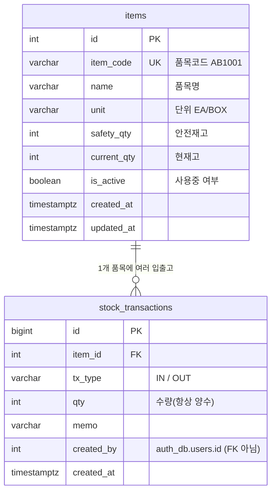
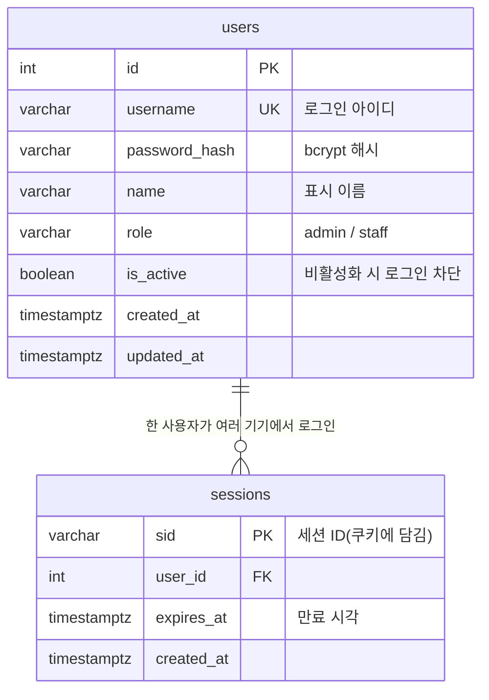

# 21. DB 설계 — 어떤 표에 무엇을 담을 것인가

> Phase 2 산출물 ②. 기획서의 기능이 실제로 **어떤 테이블**에 저장될지 정합니다.
> 작성일: 2026-11-20 / DB: PostgreSQL 19 / 접근 방식: **순수 SQL(`pg`)** — 익숙해지면 한 모듈만 ORM으로 전환해 비교

## 1. DB를 왜 두 개로 나누나

| DB | 주인 | 테이블 |
|---|---|---|
| `auth_db` | auth-service | `users`, `sessions` |
| `erp_db` | erp-service | `items`, `stock_transactions` |

서비스가 **자기 데이터는 자기만 소유**하게 하는 구조입니다. erp-service는 `auth_db`에 아예 접속하지 못합니다.

**대가(단점)도 분명합니다**: 두 DB 사이에는 **JOIN을 쓸 수 없습니다.**
입출고 이력에 "등록한 사람 이름"을 보여주려면 → erp에서 `created_by`(숫자 id)를 받아오고, 이름은 **auth에 따로 물어보거나** 화면에서 합쳐야 합니다.

> 💡 **JOIN**: 두 테이블을 **공통 값으로 이어붙여 한 번에 조회**하는 SQL 기능. 같은 DB 안에서만 됩니다.

## 2. ERD — erp_db



> 💡 **ERD**: Entity-Relationship Diagram. 테이블(네모)과 관계(선)를 그린 **DB 설계도**.
> 💡 **PK / FK / UK**: PK=각 행을 구분하는 번호표, FK=다른 표의 PK를 가리키는 연결고리, UK=중복을 허용하지 않는 칸.
> `||--o{` 는 **1 : N**(하나의 품목에 입출고 여러 건)이라는 뜻입니다.

## 3. ERD — auth_db



> `sessions`는 **세션+쿠키 방식 실습용**(Phase 5)입니다. JWT만 쓴다면 필요 없는 테이블인데, 두 방식을 비교하기로 했으므로 설계에 포함합니다.

## 4. 테이블 정의 (DDL)

> 💡 **DDL**: Data Definition Language. 테이블을 **만들고 바꾸는** SQL(`CREATE`, `ALTER`). 데이터를 다루는 `SELECT/INSERT`는 DML이라고 합니다.

### 4-1. erp_db

```sql
CREATE TABLE items (
    id          SERIAL        PRIMARY KEY,
    item_code   VARCHAR(10)   NOT NULL UNIQUE,
    name        VARCHAR(100)  NOT NULL,
    unit        VARCHAR(10)   NOT NULL DEFAULT 'EA',
    safety_qty  INTEGER       NOT NULL DEFAULT 0  CHECK (safety_qty  >= 0),
    current_qty INTEGER       NOT NULL DEFAULT 0  CHECK (current_qty >= 0),
    is_active   BOOLEAN       NOT NULL DEFAULT TRUE,
    created_at  TIMESTAMPTZ   NOT NULL DEFAULT now(),
    updated_at  TIMESTAMPTZ   NOT NULL DEFAULT now()
);

CREATE TABLE stock_transactions (
    id         BIGSERIAL    PRIMARY KEY,
    item_id    INTEGER      NOT NULL REFERENCES items(id),
    tx_type    VARCHAR(10)  NOT NULL CHECK (tx_type IN ('IN', 'OUT')),
    qty        INTEGER      NOT NULL CHECK (qty > 0),
    memo       VARCHAR(200),
    created_by INTEGER,                      -- auth_db.users.id (다른 DB라 FK 불가)
    created_at TIMESTAMPTZ  NOT NULL DEFAULT now()
);

CREATE INDEX idx_tx_item_time ON stock_transactions (item_id, created_at DESC);
CREATE INDEX idx_items_name   ON items (name);
```

### 4-2. auth_db

```sql
CREATE TABLE users (
    id            SERIAL       PRIMARY KEY,
    username      VARCHAR(20)  NOT NULL UNIQUE,
    password_hash VARCHAR(100) NOT NULL,
    name          VARCHAR(50)  NOT NULL,
    role          VARCHAR(10)  NOT NULL DEFAULT 'staff' CHECK (role IN ('admin', 'staff')),
    is_active     BOOLEAN      NOT NULL DEFAULT TRUE,
    created_at    TIMESTAMPTZ  NOT NULL DEFAULT now(),
    updated_at    TIMESTAMPTZ  NOT NULL DEFAULT now()
);

CREATE TABLE sessions (
    sid        VARCHAR(64)  PRIMARY KEY,
    user_id    INTEGER      NOT NULL REFERENCES users(id),
    expires_at TIMESTAMPTZ  NOT NULL,
    created_at TIMESTAMPTZ  NOT NULL DEFAULT now()
);

CREATE INDEX idx_sessions_expires ON sessions (expires_at);
```

## 5. 설계하며 정한 것들 (이유가 중요)

| 정한 것 | 이유 |
|---|---|
| **수량 제약은 DB에도 건다** (`CHECK (current_qty >= 0)`) | 앱 코드에 버그가 있어도 DB가 마지막 방어선이 됩니다. 검증은 **앱과 DB 양쪽**에서. |
| **`current_qty` 컬럼을 따로 둔다** | 매번 이력을 전부 더해(`SUM`) 계산하면 이력 10만 건에서 목록 조회가 느려집니다. 대신 **입출고 등록 시 이력 INSERT와 재고 UPDATE를 하나의 트랜잭션**으로 묶어 어긋나지 않게 합니다. |
| **`qty`는 항상 양수, 방향은 `tx_type`으로** | 음수 수량을 허용하면 "출고 -5"와 "입고 5"가 섞여 집계 실수가 생깁니다. |
| **삭제 대신 `is_active = false`** | 이력이 달린 품목·계정을 지우면 과거 기록이 깨집니다. (소프트 삭제) |
| **시간은 `TIMESTAMPTZ`** | 시간대 정보를 함께 저장. 서버가 클라우드(UTC)로 옮겨가도 시각이 틀어지지 않습니다. |
| **비밀번호 컬럼 이름은 `password_hash`** | `password`라고 쓰면 언젠가 누군가 평문을 넣습니다. 이름으로 못 박아 둡니다. 🛡️ |
| **`created_by`에 FK를 걸지 않음** | 다른 DB의 테이블이라 **물리적으로 불가능**합니다. DB 분리의 대가. |

## 6. 🛡️ DB 계정 — 최소 권한 원칙

앱이 슈퍼유저(`postgres`)로 접속하면, SQL 인젝션 한 번에 **DB 전체**를 잃을 수 있습니다.
서비스마다 **자기 DB에만** 접근하는 전용 계정을 만듭니다. (Phase 4에서 실제로 생성)

| 계정 | 접근 가능 DB | 권한 |
|---|---|---|
| `erp_app` | `erp_db` | SELECT, INSERT, UPDATE, DELETE (테이블 생성·삭제 권한 없음) |
| `auth_app` | `auth_db` | 동일 |
| `postgres` | 전체 | 사람이 관리할 때만 사용. 앱에서는 **절대 사용 안 함** |

## 7. 이 문서에서 나온 용어

| 용어 | 설명 |
|---|---|
| 테이블 / 행 / 컬럼 | 표 / 가로 한 줄(데이터 1건) / 세로 칸(항목) |
| ERD | 테이블과 관계를 그린 DB 설계도 |
| PK (기본키) | 행을 **유일하게 구분**하는 값. 보통 자동 증가 번호 |
| FK (외래키) | 다른 테이블의 PK를 가리키는 값. 없는 값을 못 넣게 **DB가 막아줌** |
| UNIQUE | 중복을 허용하지 않는 제약. 예: 품목코드, 아이디 |
| CHECK 제약 | "이 범위여야 한다"는 규칙을 DB에 새기는 것. 예: 수량 ≥ 0 |
| NOT NULL | 비워둘 수 없는 칸 |
| 인덱스 (Index) | 책의 **색인**. 자주 검색하는 컬럼에 만들면 조회가 빨라짐 (대신 저장은 조금 느려짐) |
| DDL / DML | 테이블을 만드는 SQL / 데이터를 다루는 SQL |
| JOIN | 두 테이블을 공통 값으로 이어붙여 조회 (같은 DB 안에서만) |
| 트랜잭션 | 여러 SQL을 **전부 성공 또는 전부 취소**로 묶는 것. 입출고에 필수 |
| 소프트 삭제 | 행을 진짜 지우지 않고 `is_active = false`로 **숨기는** 방식 |
| SERIAL / BIGSERIAL | 자동으로 1씩 증가하는 번호 컬럼 (큰 숫자용이 BIGSERIAL) |
